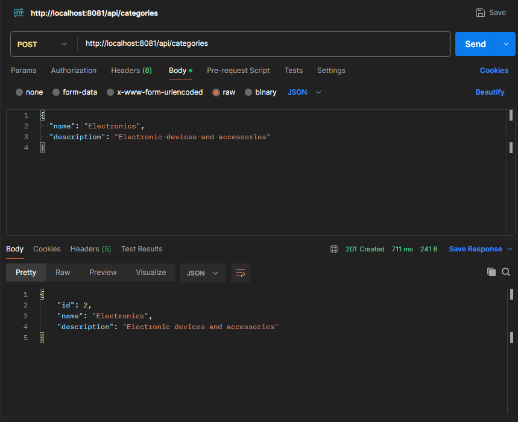
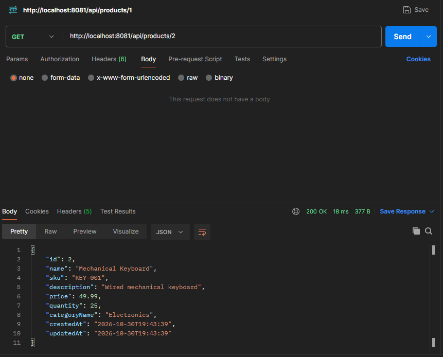
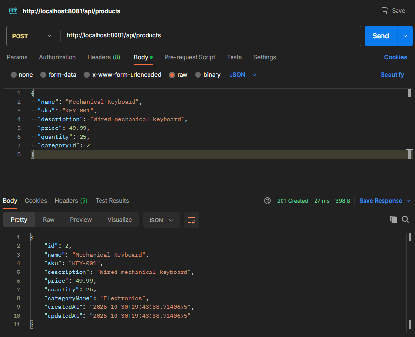
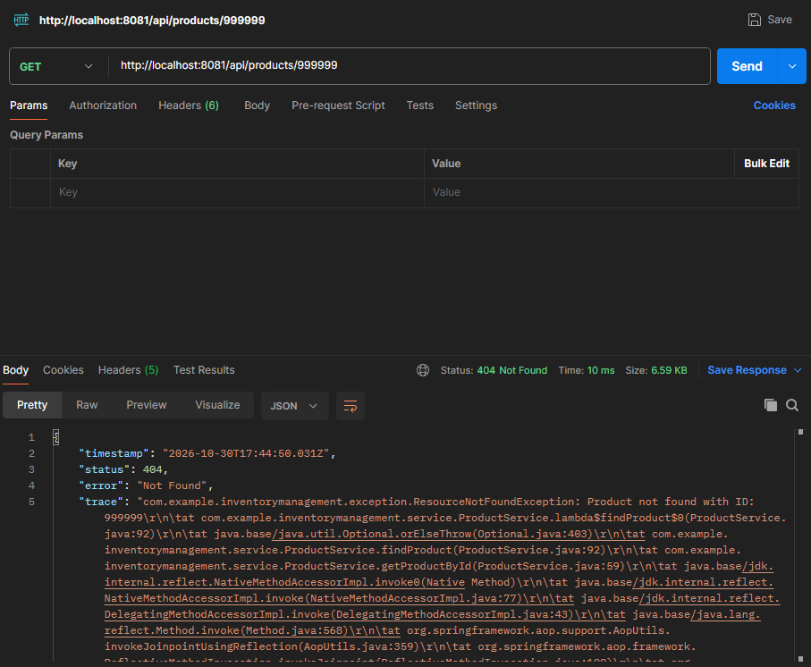
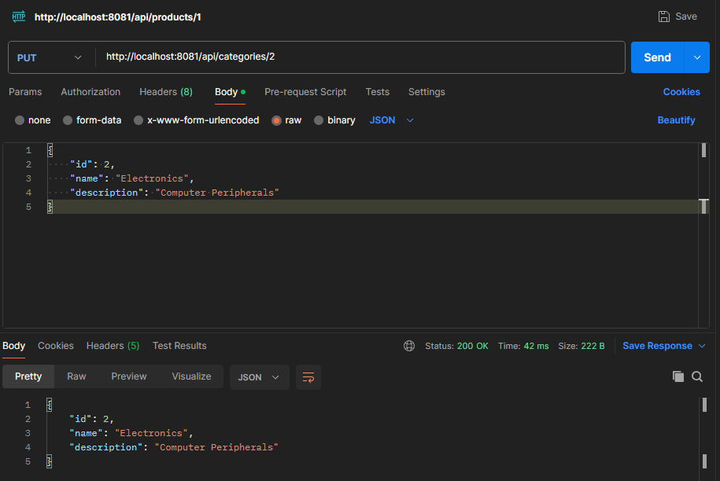

# Inventory Management API

A RESTful backend for managing products and categories, built with Java and Spring Boot and backed by a MySQL database.

> Portfolio project demonstrating REST API design, database integration, layered architecture and automated testing.

## Features

- Create, read, update and delete **products**
- Create, read, update and delete **categories**
- Products are organised by category
- DTO-based request and response handling
- Layered architecture (controller, service, repository)
- Automated tests
- Configuration through environment variables (no credentials in the codebase)

<!-- TODO: Delete any feature above that is not actually implemented, and add any that are (e.g. validation, pagination, search, error handling). -->

## Tech Stack

| Area       | Technology                    |
|------------|-------------------------------|
| Language   | Java17                        |
| Framework  | Spring Boot                   |
| Build tool | Maven                         |
| Database   | MySQL 8.x                     |
| Testing    | JUnit 5, Spring Boot Test, H2 |

## Prerequisites

- JDK 17 or newer
- Maven 3.6+
- MySQL Server 8.x running locally

## Getting Started

### 1. Clone the repository

```bash
  git clone https://github.com/SPARTAN-042/InventoryManagement.git
  cd InventoryManagement.git
```

### 2. Create the database

```sql
CREATE DATABASE inventory_management_sys;
```

### 3. Configure environment variables

The application reads its database credentials from environment variables:

| Variable      | Description         | Example                                                |
|---------------|---------------------|--------------------------------------------------------|
| `DB_URL`      | JDBC connection URL | `jdbc:mysql://localhost:3306/inventory_management_sys` |
| `DB_USERNAME` | MySQL username      | `root`                                                 |
| `DB_PASSWORD` | MySQL password      | `your_password`                                        |

**In IntelliJ IDEA:** open *Run → Edit Configurations*, select the Spring Boot configuration, and add the variables under *Environment variables*.

**From the command line:**

```bash
# macOS / Linux
export DB_URL=jdbc:mysql://localhost:3306/inventory_management_sys
export DB_USERNAME=your_username
export DB_PASSWORD=your_password
```

```powershell
# Windows (PowerShell)
$env:DB_URL="jdbc:mysql://localhost:3306/inventory_management_sys"
$env:DB_USERNAME="your_username"
$env:DB_PASSWORD="your_password"
```

### 4. Run the application

```bash 
  mvn spring-boot:run
```

The API will be available at `http://localhost:8081`.

### 5. Run the tests

```bash
  mvn test
```

## API Endpoints

### Products

| Method | Endpoint             | Description          |
|--------|----------------------|----------------------|
| GET    | `/api/products`      | Get all products     |
| GET    | `/api/products/{id}` | Get a product by ID  |
| POST   | `/api/products`      | Create a new product |
| PUT    | `/api/products/{id}` | Update a product     |
| DELETE | `/api/products/{id}` | Delete a product     |

### Categories

| Method | Endpoint               | Description           |
|--------|------------------------|-----------------------|
| GET    | `/api/categories`      | Get all categories    |
| GET    | `/api/categories/{id}` | Get a category by ID  |
| POST   | `/api/categories`      | Create a new category |
| PUT    | `/api/categories/{id}` | Update a category     |
| DELETE | `/api/categories/{id}` | Delete a category     |

### Example: create a product

**Request**

```http
POST http://localhost:8081/api/products
Content-Type: application/json
```

```json
{
  "name": "Mechanical Keyboard",
  "sku": "KEY-001",
  "description": "Wired mechanical keyboard",
  "price": 49.99,
  "quantity": 25,
  "categoryId": 2
}
```

**Response**

```json
{
  "id": 2,
  "name": "Mechanical Keyboard",
  "sku": "KEY-001",
  "description": "Wired mechanical keyboard",
  "price": 49.99,
  "quantity": 25,
  "categoryName": "Electronics",
  "createdAt": "2026-10-30T19:43:38.7140675",
  "updatedAt": "2026-10-30T19:43:38.7140675"
}
```

## Screenshots

| Create a Category                                           | Retrieve products                                    |
|-------------------------------------------------------------|------------------------------------------------------|
|  |  |

| Create a Product                                          | Error response (Retrieving invalid product)              |
|-----------------------------------------------------------|----------------------------------------------------------|
|  |  |

| Update a Category                                           |
|-------------------------------------------------------------|
|  | 

## Project Structure

```
src/
├── main/
│   ├── java/.../
│   │   ├── controller/   # REST controllers
│   │   ├── service/      # Business logic
│   │   ├── repository/   # Data access (Spring Data JPA)
│   │   ├── dto/          # Request/response objects
│   │   ├── exception/    # Exception handling 
│   │   └── entity/       # Entities (Product, Category)
│   └── resources/
│       └── application.properties
└── test/                 # Automated tests
```

## Testing

The project includes automated tests run with `mvn test`.

## License

This project is licensed under the MIT License. See the [LICENSE](LICENSE) file for details.
